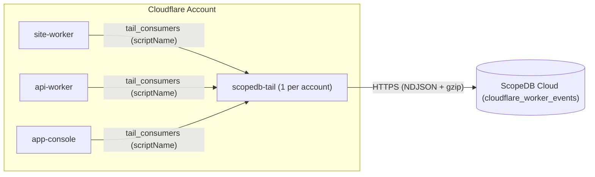

# Cloudflare Tail Worker for ScopeDB

[](https://deploy.workers.cloudflare.com/?url=https://github.com/scopedb/cloudflare-tail-worker)

Stream Cloudflare Worker invocations, `console.*` logs, and uncaught exceptions directly into [ScopeDB](https://www.scopedb.io) without modifying your application Workers.

## How it works

In Cloudflare Workers, a single [Tail Worker](https://developers.cloudflare.com/workers/observability/logs/tail-workers/) (`scopedb-tail`) can receive execution events from any number of producer Workers in the same Cloudflare account via `tail_consumers`. Every event batch delivered by Cloudflare includes the producer Worker's `scriptName`, which `scopedb-tail` maps to the `service` column in ScopeDB:



- **Zero application code changes**: Producer Workers only add `tail_consumers = [{ service = "scopedb-tail" }]` to `wrangler.toml`.
- **Web-native runtime**: Built on the [`scopedb`](https://github.com/scopedb/scopedb-js) Web Fetch + `CompressionStream` runtime; no `nodejs_compat` required.
- **Explore fields without changing the table**: Query parameters and structured log arguments remain nested in `attributes`, backed by ScopeDB's semi-structured values. Query a new campaign or application parameter without deploying a new column mapping.
- **Reusable analysis views**: Start with invocation metrics, error investigation, browser document requests, or AI/content access signals, then adapt the ScopeQL definitions to your application's meaning.
- **Explicit capture policy**: Captures all query parameters visible to the Tail Worker by default, with optional allowlisting and value redaction. Request and Referer paths receive heuristic token redaction. This is not comprehensive removal of credentials or personal data; see [capture policy](#capture-policy).
- **Separate execution and storage costs**: Tail Workers require Workers Paid or Enterprise and are billed by CPU time rather than per-request charges. This template disables its own invocation logs while retaining error diagnostics. Any enabled Workers Logs on the producer or consumer are billed separately, as is ScopeDB storage and compute.

## 3-step quickstart

### 1. Create the table and views in ScopeDB

Apply the Catalog YAML definitions in [`catalog/`](catalog) using the [ScopeDB CLI](https://www.scopedb.io/docs/guides/scopedb-cli/catalog):

```bash
scope catalog apply --table scopedb.public.cloudflare_worker_events -f catalog/table.yaml
scope catalog apply --view scopedb.public.v_cloudflare_requests -f catalog/v_cloudflare_requests.yaml
scope catalog apply --view scopedb.public.v_cloudflare_pageviews -f catalog/v_cloudflare_pageviews.yaml
scope catalog apply --view scopedb.public.v_cloudflare_errors -f catalog/v_cloudflare_errors.yaml
scope catalog apply --view scopedb.public.v_cloudflare_ai_bots -f catalog/v_cloudflare_ai_bots.yaml
```

| Object                                    | Kind  | Definition                                                                   | Purpose                                                                                                             |
| ----------------------------------------- | ----- | ---------------------------------------------------------------------------- | ------------------------------------------------------------------------------------------------------------------- |
| `scopedb.public.cloudflare_worker_events` | Table | [`catalog/table.yaml`](catalog/table.yaml)                                   | Base event table storing `worker.invocation`, `worker.log`, and `worker.exception` rows clustered by `service`      |
| `scopedb.public.v_cloudflare_requests`    | View  | [`catalog/v_cloudflare_requests.yaml`](catalog/v_cloudflare_requests.yaml)   | Flattened HTTP/Worker invocation metrics (`wall_time_ms`, `cpu_time_ms`, `colo`, `country`, `user_agent`, `status`) |
| `scopedb.public.v_cloudflare_pageviews`   | View  | [`catalog/v_cloudflare_pageviews.yaml`](catalog/v_cloudflare_pageviews.yaml) | Successful browser document requests observed by Workers; not complete SPA pageviews                                |
| `scopedb.public.v_cloudflare_errors`      | View  | [`catalog/v_cloudflare_errors.yaml`](catalog/v_cloudflare_errors.yaml)       | All `5xx` responses, non-`ok` Worker outcomes, `console.error` logs, and uncaught exceptions with stack traces      |
| `scopedb.public.v_cloudflare_ai_bots`     | View  | [`catalog/v_cloudflare_ai_bots.yaml`](catalog/v_cloudflare_ai_bots.yaml)     | AI identity signals and Markdown/llms.txt requests, exposed as separate flags                                       |

### 2. Deploy `scopedb-tail` once in your Cloudflare account

Click **Deploy to Cloudflare** above, or clone this repository and deploy with Wrangler:

```bash
git clone https://github.com/scopedb/cloudflare-tail-worker.git
cd cloudflare-tail-worker
pnpm install
pnpm exec wrangler secret put SCOPEDB_ENDPOINT
pnpm exec wrangler secret put SCOPEDB_API_KEY
pnpm run deploy
```

| Binding            | Type   | Default                    | Description                                                                  |
| ------------------ | ------ | -------------------------- | ---------------------------------------------------------------------------- |
| `SCOPEDB_ENDPOINT` | Secret | *(Required)*               | ScopeDB Cloud workspace endpoint (for example, `https://<id>.scopedb.cloud`) |
| `SCOPEDB_API_KEY`  | Secret | *(Required)*               | ScopeDB workspace API key with append access to the target table             |
| `SCOPEDB_DATABASE` | Var    | `scopedb`                  | Target database name in [wrangler.toml](wrangler.toml)                       |
| `SCOPEDB_SCHEMA`   | Var    | `public`                   | Target schema name in [wrangler.toml](wrangler.toml)                         |
| `SCOPEDB_TABLE`    | Var    | `cloudflare_worker_events` | Target table name in [wrangler.toml](wrangler.toml)                          |

### 3. Attach your producer Workers

Add `tail_consumers` to the `wrangler.toml` of each Worker in your Cloudflare account that you want to observe, then redeploy those Workers:

```toml
tail_consumers = [{ service = "scopedb-tail" }]
```

If a producer Worker defines named environments (such as `[env.staging]` and `[env.production]`), add `tail_consumers = [{ service = "scopedb-tail" }]` under each environment block in `wrangler.toml`.

## Data and analysis contracts

Each delivered invocation becomes one `worker.invocation` row, plus one row per console log or exception. `attributes['invocation_id']` links them. Count invocation rows for request volume; counting the base table or error view counts events and can count one invocation multiple times. Non-HTTP invocations also produce rows, with HTTP fields set to null. Filter `method IS NOT NULL` when measuring HTTP traffic.

The collector stores request facts and selected edge metadata. Application parameters remain in `attributes['query']` as an object of string arrays: `?tag=a&tag=b&empty=` becomes `{"tag":["a","b"],"empty":[""]}`. Values are URL-decoded once, duplicates retain their order, and keys are case-sensitive. Values are not truncated or heuristically redacted by the collector. Cloudflare may already have replaced parts of the incoming URL with `REDACTED`; the collector does not recover or request unredacted values. The UTM/ref columns in the views select the first occurrence from this object, with a fallback to top-level attributes on older records.

Views define analysis rules rather than additional ingestion schemas:

- `v_cloudflare_requests` exposes one row per invocation, including HTTP context, timings, attribution, and Cloudflare's `truncated` flag. Truncated events may contain incomplete logs or exceptions.
- `v_cloudflare_pageviews` selects successful GET requests with `Sec-Fetch-Mode: navigate` and `Sec-Fetch-Dest: document`, excluding prefetches, RSC, known bots, and common non-page paths. It measures observable browser document requests. Browsers without these headers, SPA client-side navigation, browser-cache hits, and static assets served without invoking a Worker are outside this count. Full SPA navigation analytics requires a browser navigation event source.
- `v_cloudflare_ai_bots` exposes `is_verified_ai_bot` (Cloudflare AI categories), `is_ai_user_agent` (a spoofable UA match), and `is_markdown_request` (content access). It includes rows matching any signal. A Markdown request alone is not evidence of an AI visitor, and a verified search crawler or uptime monitor alone does not qualify as AI.
- `v_cloudflare_errors` exposes error events for investigation. Use invocation IDs to correlate or deduplicate failures.

Tail observes Worker executions, not every request to a domain. Check the producer's [static asset routing](https://developers.cloudflare.com/workers/static-assets/binding/#run_worker_first) if important URLs bypass the Worker. Running the Worker first on those routes increases execution work. Tail events also arrive after an invocation completes, which matters for long-lived requests.

## Example ScopeQL queries

### Compare request volume, errors, and CPU time by Worker service

```scopeql
FROM scopedb.public.v_cloudflare_requests
WHERE occurred_at >= NOW() - '24h'::interval
  AND method IS NOT NULL
GROUP BY service
AGGREGATE
    count() AS requests,
    sum(if(status >= 500 OR outcome != 'ok', 1, 0)) AS errors,
    avg(wall_time_ms) AS avg_wall_ms,
    max(cpu_time_ms) AS max_cpu_ms
ORDER BY requests DESC
```

### Inspect recent 5xx failures and uncaught exceptions

```scopeql
FROM scopedb.public.v_cloudflare_errors
WHERE occurred_at >= NOW() - '6h'::interval
SELECT occurred_at, service, event_type, outcome, status, path, message, ray_id, stack
ORDER BY occurred_at DESC
LIMIT 50
```

### See identified AI traffic reading Markdown or `/llms.txt`

```scopeql
FROM scopedb.public.v_cloudflare_ai_bots
WHERE occurred_at >= NOW() - '168h'::interval
  AND (is_verified_ai_bot OR is_ai_user_agent)
  AND is_markdown_request
GROUP BY path, user_agent, as_organization
AGGREGATE count() AS fetches
ORDER BY fetches DESC
LIMIT 25
```

### Analyze document requests by referrer, campaign, and geography

```scopeql
FROM scopedb.public.v_cloudflare_pageviews
WHERE occurred_at >= NOW() - '168h'::interval
GROUP BY continent, country, referer_host, referer_path, utm_source
AGGREGATE count() AS document_requests
ORDER BY document_requests DESC
LIMIT 25
```

### Explore an application parameter without changing ingestion

```scopeql
FROM scopedb.public.v_cloudflare_requests
WHERE occurred_at >= NOW() - '24h'::interval
SELECT occurred_at, service, path, query['plan'][0]::string AS plan, query['tag'] AS tags
ORDER BY occurred_at DESC
LIMIT 50
```

### Correlate all logs and exceptions from a single invocation

```scopeql
FROM scopedb.public.cloudflare_worker_events
WHERE attributes['invocation_id']::string = '<invocation_id>'
SELECT occurred_at, event_type, level, message, attributes
ORDER BY occurred_at ASC
```

## Render web and AI traffic charts with `$scopedb` and `@scopedb/scopeview`

With the [ScopeDB Agent Skill](https://github.com/scopedb/scopedb-skills) (`$scopedb`) and [`@scopedb/scopeview`](https://github.com/scopedb/scopeview), your coding agent can query `v_cloudflare_pageviews` and `v_cloudflare_ai_bots` and export offline interactive HTML charts on demand:

```text
Use $scopedb to analyze our Cloudflare web and AI traffic over the last 168 hours from scopedb.public.v_cloudflare_pageviews and scopedb.public.v_cloudflare_ai_bots, and render @scopedb/scopeview interactive HTML charts for:
1. Hourly or 5-minute browser document requests over time (line chart)
2. Top 15 document paths (top-list chart)
3. Top external referrers and UTM sources (top-list chart)
4. Top visitor countries and cities (top-list chart)
5. Markdown/llms.txt fetches, split by verified AI, AI user-agent, and content-only signals (top-list chart)
Label counts as observed requests, not unique visitors or complete SPA pageviews.
```

## Capture policy

Full query capture can retain credentials, email addresses, search terms, and other personal or application data. Cloudflare's [TailRequest redaction](https://developers.cloudflare.com/workers/runtime-apis/handlers/tail/#tailrequest) is heuristic and can miss prefixed tokens, short codes, or encoded values. Retention and access controls must match the data you choose to capture.

The collector omits URL fragments, Referer query strings, raw client-IP fields, and sensitive request headers. It redacts recognizable hex/base64-like tokens and payment-card patterns in decoded request and Referer path segments, including prefixed hex tokens. Paths are limited to 2,048 characters and exception stacks to 8,192. Short secrets and personal data in paths need an application rule. Console arguments and exception messages are normalized for serialization, not scrubbed for secrets or personal data.

Configure the exported `createTailWorker` in [src/index.ts](src/index.ts), or import it from a separate entrypoint and set Wrangler's `main` to that file. `allowedQueryParams` optionally restricts keys; `[]` disables query capture. `redactQueryValue` receives each decoded value and can return null to omit it. `redactPath` applies to both request and Referer pathnames and can return null to omit the path. For example, a deployment that only needs campaign/plan attribution and has short reset tokens can use:

```ts
import { createTailWorker } from "./src/index.js";

export default createTailWorker({
  allowedQueryParams: ["utm_source", "utm_medium", "utm_campaign", "plan"],
  redactQueryValue: (key, value) => key === "plan" && !["free", "team"].includes(value) ? null : value,
  redactPath: (pathname) => pathname.replace(/^\/reset\/[^/]+/, "/reset/:token"),
});
```

## Filtering and delivery

The default collector does not sample. `shouldRecord` filters entire invocations, including their logs and exceptions. For example, omit successful health checks while retaining error logs even when the HTTP response was successful:

```ts
import { createTailWorker } from "./src/index.js";

export default createTailWorker({
  shouldRecord: (item) => {
    const status = item.event?.response?.status ?? 0;
    if (item.outcome !== "ok" || status >= 400 || (item.exceptions?.length ?? 0) > 0
      || item.logs?.some((log) => log.level === "error")) {
      return true;
    }
    return item.event?.request?.url === undefined
      || new URL(item.event.request.url).pathname !== "/health";
  },
});
```

Random filtering changes counts and can bias error rates. The supplied views do not compensate for sampling; do not interpret sampled counts as totals without recording selection probabilities and adapting the analysis.

Each Tail invocation sends its own batch to ScopeDB and waits for delivery. This is not a persistent queue or cross-invocation batcher. The SDK retries eligible failures up to twice, with a 10-second attempt timeout and a 25-second elapsed budget per batch. Network failures and timeouts can leave the commit outcome unknown; the collector reports failure without automatically replaying an ambiguous write. There is no durable replay buffer. Monitor consumer failures and compare received volume with producer metrics. Applications needing durable delivery should introduce a persistent queue and an explicit replay/deduplication policy.

The Tail Worker's automatic invocation logs are disabled in [wrangler.toml](wrangler.toml); error diagnostics remain enabled. This does not change producer Workers Logs settings or make enabled log storage free.

## Upgrading an existing deployment

Worker code and database views are separate deployment artifacts. The GitHub workflow deploys Worker code on `main`; it does not apply Catalog YAML. Before merging a collector change that alters attributes, apply the matching views to the destination database using the commands in step 1. Apply all four views for this update, then deploy the Worker. If you customized the database, schema, or table bindings, update the table references in the view YAML as well.

These views read UTM/ref from both older top-level attributes and the new array-valued query object, so they can be applied before the collector changes. `landing_page` and `from_page` are no longer dedicated columns: use `query['landing_page'][0]::string` and `query['from_page'][0]::string` for new data. Older values remain in the base table's top-level attributes; there is no query backfill. For analysis spanning the transition, use `if(attributes['query'] IS NULL, attributes['landing_page']::string, attributes['query']['landing_page'][0]::string)` against the base table. Keep the compatible views if rolling back only the collector.

After rollout, verify a known document request, a repeated query parameter, and an error invocation in ScopeDB. Check the new AI/content flags and compare document-request counts before and after the stricter navigation filter; that filter intentionally changes the metric. Do not interpret this view update as a traffic change.

## Development

```bash
pnpm install
pnpm run ci
```

The default CI checks conversion, SDK transport, types, and Worker bundling. To execute all four Catalog definitions against a local ScopeDB server with configured PostgreSQL and object storage:

```bash
SCOPEDB_TEST_ENDPOINT=http://127.0.0.1:6543 pnpm run test:catalog
```

This integration test creates a uniquely named temporary database, ingests current and historical event fixtures, verifies the view results, and deletes the database afterward. It covers duplicate query values, UTM compatibility, navigation filtering, AI/content classification, and successful responses containing error logs.

## License

Licensed under the [Apache License, Version 2.0](LICENSE).
