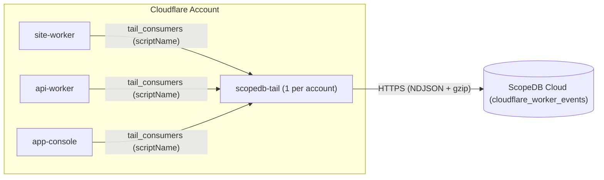

# Cloudflare Tail Worker for ScopeDB

[](https://deploy.workers.cloudflare.com/?url=https://github.com/scopedb/cloudflare-tail-worker)

Stream Cloudflare Worker invocations, `console.*` logs, uncaught exceptions, and first-party application telemetry (browser RUM, distributed trace spans, and custom events) directly into [ScopeDB](https://www.scopedb.io).

## How it works

In Cloudflare Workers, a single [Tail Worker](https://developers.cloudflare.com/workers/observability/logs/tail-workers/) (`scopedb-tail`) can receive execution events from any number of producer Workers in the same Cloudflare account via `tail_consumers`. Every event batch delivered by Cloudflare includes the producer Worker's `scriptName`, which `scopedb-tail` maps to the `service` column in ScopeDB:



- **Zero application code changes required**: Producer Workers only add `tail_consumers = [{ service = "scopedb-tail" }]` to `wrangler.toml` to capture HTTP invocations, logs, and exceptions.
- **First-party RUM and trace spans without producer secrets**: Producer Workers can also emit structured `rum.*`, `trace.span`, and `app.*` events via `console.info(...)`, inheriting trusted Cloudflare edge metadata (`service`, `ray_id`, GeoIP) without binding ScopeDB credentials on producer Workers.
- **Web-native runtime**: Built on the [`scopedb`](https://github.com/scopedb/scopedb-js) Web Fetch + `CompressionStream` runtime; no `nodejs_compat` required.
- **Explore fields without changing the table**: Query parameters, structured log arguments, RUM context, and span attributes remain nested in `attributes`, backed by ScopeDB's semi-structured values.
- **Reusable analysis views**: Start with HTTP invocation metrics, error investigation, browser document requests, AI/content access signals, first-party browser RUM, and distributed trace spans, then adapt the ScopeQL definitions to your application.
- **Defense-in-depth capture policy**: Redacts sensitive query parameter keys (`code`, `state`, `token`, `session_id`, `api_key`, and similar credentials), embedded URLs/paths in query values, and hex/opaque tokens in request, Referer, and RUM paths by default, with optional query allowlisting and custom redaction hooks; see [capture policy](#capture-policy).
- **Works on Cloudflare Free and Paid plans with zero Cloudflare Observability storage**: `tail_consumers` operates independently of Cloudflare Workers Logs and Traces storage. Setting `[observability] enabled = false` (or `persist = false` when exporting OpenTelemetry elsewhere) on `scopedb-tail` and producer Workers avoids duplicate Cloudflare Observability ingestion and retention charges.

## 3-step quickstart

### 1. Create the table and views in ScopeDB

Apply the Catalog YAML definitions in [`catalog/`](catalog) using the [ScopeDB CLI](https://www.scopedb.io/docs/guides/scopedb-cli/catalog):

```bash
scope catalog apply --yes --table scopedb.public.cloudflare_worker_events -f catalog/table.yaml
scope catalog apply --yes --view scopedb.public.v_cloudflare_requests -f catalog/v_cloudflare_requests.yaml
scope catalog apply --yes --view scopedb.public.v_cloudflare_pageviews -f catalog/v_cloudflare_pageviews.yaml
scope catalog apply --yes --view scopedb.public.v_cloudflare_errors -f catalog/v_cloudflare_errors.yaml
scope catalog apply --yes --view scopedb.public.v_cloudflare_ai_bots -f catalog/v_cloudflare_ai_bots.yaml
scope catalog apply --yes --view scopedb.public.v_cloudflare_rum -f catalog/v_cloudflare_rum.yaml
scope catalog apply --yes --view scopedb.public.v_cloudflare_traces -f catalog/v_cloudflare_traces.yaml
```

| Object                                    | Kind  | Definition                                                                   | Purpose                                                                                                                  |
| ----------------------------------------- | ----- | ---------------------------------------------------------------------------- | ------------------------------------------------------------------------------------------------------------------------ |
| `scopedb.public.cloudflare_worker_events` | Table | [`catalog/table.yaml`](catalog/table.yaml)                                   | Base event table storing `worker.*`, `rum.*`, `trace.span`, and `app.*` rows clustered by `service` and `occurred_at`    |
| `scopedb.public.v_cloudflare_requests`    | View  | [`catalog/v_cloudflare_requests.yaml`](catalog/v_cloudflare_requests.yaml)   | Flattened HTTP/Worker invocation metrics (`wall_time_ms`, `cpu_time_ms`, `colo`, `country`, `user_agent`, `status`)      |
| `scopedb.public.v_cloudflare_pageviews`   | View  | [`catalog/v_cloudflare_pageviews.yaml`](catalog/v_cloudflare_pageviews.yaml) | Successful browser document requests observed by Workers; pair with `v_cloudflare_rum` for full SPA navigation analytics |
| `scopedb.public.v_cloudflare_errors`      | View  | [`catalog/v_cloudflare_errors.yaml`](catalog/v_cloudflare_errors.yaml)       | Worker `5xx` responses, non-`ok`/non-`canceled` outcomes, application `console.error` logs, and uncaught exceptions      |
| `scopedb.public.v_cloudflare_ai_bots`     | View  | [`catalog/v_cloudflare_ai_bots.yaml`](catalog/v_cloudflare_ai_bots.yaml)     | AI identity signals and Markdown/`/llms.txt` requests, exposed as separate flags                                         |
| `scopedb.public.v_cloudflare_rum`         | View  | [`catalog/v_cloudflare_rum.yaml`](catalog/v_cloudflare_rum.yaml)             | First-party browser RUM pageviews, Web Vitals (`LCP`, `INP`, `CLS`), user actions, and client errors                     |
| `scopedb.public.v_cloudflare_traces`      | View  | [`catalog/v_cloudflare_traces.yaml`](catalog/v_cloudflare_traces.yaml)       | Distributed BFF and Worker trace spans (`trace_id`, `span_id`, `parent_span_id`, `duration_ms`, failure diagnostics)     |

### 2. Deploy `scopedb-tail` once in your Cloudflare account

Click **Deploy to Cloudflare** above, or clone this repository and deploy with Wrangler:

```bash
git clone https://github.com/scopedb/cloudflare-tail-worker.git
cd cloudflare-tail-worker
pnpm install
pnpm exec wrangler secret put SCOPEDB_ENDPOINT
pnpm exec wrangler secret put SCOPEDB_API_KEY
pnpm run deploy
```

| Binding            | Type   | Default                    | Description                                                                  |
| ------------------ | ------ | -------------------------- | ---------------------------------------------------------------------------- |
| `SCOPEDB_ENDPOINT` | Secret | *(Required)*               | ScopeDB Cloud workspace endpoint (for example, `https://<id>.scopedb.cloud`) |
| `SCOPEDB_API_KEY`  | Secret | *(Required)*               | ScopeDB workspace API key with append access to the target table             |
| `SCOPEDB_DATABASE` | Var    | `scopedb`                  | Target database name in [wrangler.toml](wrangler.toml)                       |
| `SCOPEDB_SCHEMA`   | Var    | `public`                   | Target schema name in [wrangler.toml](wrangler.toml)                         |
| `SCOPEDB_TABLE`    | Var    | `cloudflare_worker_events` | Target table name in [wrangler.toml](wrangler.toml)                          |

### 3. Attach your producer Workers

Add `tail_consumers` to the `wrangler.toml` of each Worker in your Cloudflare account that you want to observe, disable duplicate Cloudflare Observability persistence if ScopeDB is your sole destination, and redeploy those Workers:

```toml
tail_consumers = [{ service = "scopedb-tail" }]

[observability]
enabled = false
```

If a producer Worker defines named environments (such as `[env.staging]` and `[env.production]`), add `tail_consumers = [{ service = "scopedb-tail" }]` under each environment block in `wrangler.toml`. If you also export OpenTelemetry directly from Cloudflare to an external destination, set `persist = false` under `[observability.logs]` and `[observability.traces]` instead of `enabled = false`.

## Data and analysis contracts

Each delivered invocation produces one `worker.invocation` row, plus one row per plain console log, uncaught exception, or structured application telemetry event. `attributes['invocation_id']` links all rows emitted during the same Worker execution, and `attributes['truncated']` records whether Cloudflare truncated the upstream trace item on every row type. Count `worker.invocation` rows (or query `v_cloudflare_requests`) for request volume; counting the base table counts all event types. Non-HTTP invocations produce `worker.invocation` rows with HTTP fields set to null; filter `method IS NOT NULL` when measuring HTTP traffic.

Application query parameters are stored in `attributes['query']` as an object of string arrays: `?tag=a&tag=b&empty=` becomes `{"tag":["a","b"],"empty":[""]}`. Values are URL-decoded, duplicates retain their order, keys are case-sensitive, and sensitive keys or token/path patterns in values are redacted by default (see [capture policy](#capture-policy)). The UTM/ref columns in `v_cloudflare_requests`, `v_cloudflare_pageviews`, and `v_cloudflare_rum` resolve campaign attribution from either top-level `attributes` or `attributes['query']`.

Views define analysis rules rather than separate ingestion schemas:

- `v_cloudflare_requests` exposes one row per `worker.invocation`, including HTTP context, timings, attribution, `trace_id`, and `truncated`.
- `v_cloudflare_pageviews` selects successful `GET` `worker.invocation` rows with `Sec-Fetch-Mode: navigate` and `Sec-Fetch-Dest: document`, excluding prefetches, RSC fetches, known bots, and non-page asset paths. It measures server-observed browser document navigations; use `v_cloudflare_rum` for client-side SPA route transitions and Web Vitals.
- `v_cloudflare_ai_bots` exposes `is_verified_ai_bot` (Cloudflare AI bot categories), `is_ai_user_agent` (user-agent match), and `is_markdown_request` (`.md`, `/llms.txt`, or `Accept: text/markdown`) across `worker.invocation` rows.
- `v_cloudflare_errors` focuses on actionable Worker failures across `worker.*` events: uncaught `worker.exception` rows (without duplicating their parent `worker.invocation` row), `worker.invocation` rows with `status >= 500` or non-`ok`/non-`canceled` outcomes (such as `exceededCpu`), and `worker.log` rows at `level = 'error'` excluding routine `status = 404` route misses on `outcome = 'ok'` invocations and non-`error` logs on `5xx` responses.
- `v_cloudflare_rum` flattens `rum.pageview`, `rum.vital`, `rum.action`, and `rum.error` events emitted through the structured telemetry envelope, combining client RUM context (`session_id`, `view_id`, `trace_id`, `vital_name`, `vital_value`, `action_name`) with trusted edge GeoIP metadata.
- `v_cloudflare_traces` flattens `trace.span` events for BFF and Worker request tracing (`trace_id`, `span_id`, `parent_span_id`, `span_kind`, `duration_ms`, `http_route`, `error_type`, `failure_stage`, and `request_outcome`).

Tail observes Worker executions, not every request to a domain. Check the producer's [static asset routing](https://developers.cloudflare.com/workers/static-assets/binding/#run_worker_first) if important URLs bypass the Worker. Assets-only Workers without a `main` entrypoint do not invoke Worker code and emit no Tail events unless wrapped by a Worker script. Tail events also arrive after an invocation completes, which matters for long-lived requests.

## Structured application telemetry (RUM, traces, and app events)

Producer Workers already bound to `scopedb-tail` can emit first-party browser RUM beacons, BFF trace spans, and custom `app.*` events by logging a single `{ __scopedb_telemetry: 1, events: [...] }` object (or JSON string up to 128 KiB) via `console.info(...)`. A valid envelope emits up to 64 structured rows into `cloudflare_worker_events` and suppresses the raw `worker.log` row, while keeping `v_cloudflare_requests`, `v_cloudflare_pageviews`, `v_cloudflare_ai_bots`, and `v_cloudflare_errors` strictly scoped to `worker.*` events:

```ts
// Inside a producer Worker (for example, POST /api/telemetry or a BFF tracing hook):
console.info({
  __scopedb_telemetry: 1,
  environment: "production",
  app_version: "2026.11.1",
  events: [
    {
      event_type: "rum.pageview",
      occurred_at: Date.now(),
      path: "/docs/guides/analyze-cloudflare-worker-traffic?utm_source=github",
      referrer: "https://github.com/scopedb/cloudflare-tail-worker",
      trace_id: "4bf92f3577b34da6a3ce929d0e0e4736",
      attributes: {
        session_id: "c9b1e580-3f8b-4a1a-9d6a-7b4d2e9c1a01",
        view_id: "7a12c3d4-9e01-4b2c-8f3a-1b2c3d4e5f60",
      },
    },
    {
      event_type: "rum.vital",
      path: "/docs/guides/analyze-cloudflare-worker-traffic",
      attributes: {
        session_id: "c9b1e580-3f8b-4a1a-9d6a-7b4d2e9c1a01",
        vital_name: "LCP",
        vital_value: 842.5,
        vital_rating: "good",
      },
    },
    {
      event_type: "trace.span",
      method: "POST",
      path: "/api/query",
      status: 200,
      trace_id: "4bf92f3577b34da6a3ce929d0e0e4736",
      span_id: "00f067aa0ba902b7",
      duration_ms: 34.2,
      attributes: {
        span_name: "POST /api/query",
        span_kind: "SERVER",
        status_code: "OK",
        http_route: "/api/query",
      },
    },
  ],
});
```

- **Allowed `event_type` namespaces**: `rum.pageview`, `rum.vital`, `rum.action`, `rum.error`, `trace.span`, and `app.<name>` (`/^app\.[a-z0-9][a-z0-9_.-]{0,63}$/`). Collector-reserved `worker.*` types are rejected.
- **Trusted edge fields**: `service`, `ray_id`, `attributes['invocation_id']`, `attributes['truncated']`, `attributes['script_version_id']`, `attributes['user_agent']`, and Cloudflare `cf` GeoIP fields (`colo`, `continent`, `country`, `region`, `city`, `timezone`, `asn`, `as_organization`) are always stamped from the `TailItem` and cannot be spoofed by client payloads.
- **Automatic URL sanitization**: `path` and `referrer` on structured events pass through the same collector path, sensitive query-key, and token redaction pipeline as `worker.invocation` URLs, and never inherit `POST /api/telemetry` or HTTP `204` from the beacon transport endpoint. Use anonymous random IDs for `attributes['session_id']`, never authentication cookies or bearer tokens.

## Example ScopeQL queries

### Compare request volume, errors, and CPU time by Worker service

```scopeql
FROM scopedb.public.v_cloudflare_requests
WHERE occurred_at >= NOW() - '24h'::interval
  AND method IS NOT NULL
GROUP BY service
AGGREGATE
    count() AS requests,
    sum(if(status >= 500 OR (outcome != 'ok' AND outcome != 'canceled'), 1, 0)) AS errors,
    avg(wall_time_ms) AS avg_wall_ms,
    max(cpu_time_ms) AS max_cpu_ms
ORDER BY requests DESC
```

### Inspect recent 5xx failures and uncaught exceptions

```scopeql
FROM scopedb.public.v_cloudflare_errors
WHERE occurred_at >= NOW() - '6h'::interval
SELECT occurred_at, service, event_type, outcome, status, path, message, ray_id, stack
ORDER BY occurred_at DESC
LIMIT 50
```

### See identified AI traffic reading Markdown or `/llms.txt`

```scopeql
FROM scopedb.public.v_cloudflare_ai_bots
WHERE occurred_at >= NOW() - '168h'::interval
  AND (is_verified_ai_bot OR is_ai_user_agent)
  AND is_markdown_request
GROUP BY path, user_agent, as_organization
AGGREGATE count() AS fetches
ORDER BY fetches DESC
LIMIT 25
```

### Analyze SPA pageviews and Web Vitals from first-party RUM

```scopeql
FROM scopedb.public.v_cloudflare_rum
WHERE occurred_at >= NOW() - '168h'::interval
  AND event_type = 'rum.vital'
GROUP BY service, vital_name, vital_rating
AGGREGATE
    count() AS samples,
    avg(vital_value) AS avg_value
ORDER BY service, vital_name, samples DESC
```

### Correlate browser RUM actions and BFF spans by `trace_id`

```scopeql
FROM scopedb.public.cloudflare_worker_events
WHERE attributes['trace_id']::string = '<trace_id>'
SELECT occurred_at, service, event_type, level, method, path, status, message, attributes
ORDER BY occurred_at ASC
```

### Explore an application parameter without changing ingestion

```scopeql
FROM scopedb.public.v_cloudflare_requests
WHERE occurred_at >= NOW() - '24h'::interval
  AND query::string != '{}'
SELECT occurred_at, service, path, query['plan'][0]::string AS plan, query['tag'] AS tags
ORDER BY occurred_at DESC
LIMIT 50
```

## Render web and AI traffic charts with `$scopedb` and `@scopedb/scopeview`

With [`@scopedb/scopeview`](https://github.com/scopedb/scopeview), your coding agent can query `v_cloudflare_pageviews`, `v_cloudflare_rum`, and `v_cloudflare_ai_bots` and export offline interactive HTML charts on demand:

```text
Analyze our Cloudflare web and AI traffic over the last 168 hours from scopedb.public.v_cloudflare_pageviews and scopedb.public.v_cloudflare_ai_bots, and render @scopedb/scopeview interactive HTML charts for:
1. Hourly browser document requests over time using floor(occurred_at, n => 1, unit => 'hour') (line chart)
2. Top 15 document paths (top-list chart)
3. Top external referrers and UTM sources (top-list chart)
4. Top visitor countries and cities (top-list chart)
5. Markdown/llms.txt fetches, split by verified AI, AI user-agent, and content-only signals (top-list chart)
Label counts from v_cloudflare_pageviews as server-observed document requests, not unique visitors.
```

## Capture policy

Query parameters and paths can carry credentials, email addresses, search terms, and other personal or application data. Cloudflare's upstream [TailRequest redaction](https://developers.cloudflare.com/workers/runtime-apis/handlers/tail/#tailrequest) is heuristic and can miss short codes, prefixed tokens, or URL-encoded redirect paths. Retention and access controls must match the data you choose to capture.

By default, the collector omits URL fragments, Referer query strings, raw client-IP fields, and sensitive request headers (`Authorization`, `Cookie`, `CF-Connecting-IP`). Across request URLs, Referer headers, and structured telemetry `path`/`referrer` fields, the collector applies defense-in-depth redaction:

- **Sensitive query keys**: Case-insensitive keys `code`, `state`, `token`, `access_token`, `refresh_token`, `id_token`, `api_key`, `apikey`, `key`, `secret`, `client_secret`, `password`, `passwd`, `signature`, `sig`, `x-amz-signature`, `x-amz-security-token`, `authorization`, `auth`, `session`, `session_id`, `cookie`, `otp`, `invite`, and `invitation` have their values replaced with `"REDACTED"`.
- **Query values and embedded paths/URLs**: Decoded query values are scanned for tokens and nested paths or URLs (for example, `?returnTo=%2Finvitations%2F<token>` becomes `/invitations/REDACTED`), while non-secret application parameters and duplicate values retain their decoded values and order.
- **Path and token heuristics**: Decoded path segments and query values redact `>=12`-character hex identifiers (such as `/workspaces/777257d6587f`), `>=20`-character opaque alphanumeric or non-word single-case tokens (such as `/invitations/aaaaaaaaaaaaaaaaaaaaaaaa`), `>=21`-character mixed-case+digit tokens, prefixed tokens (`tok_...`), and 13–19 digit Luhn card numbers, while preserving normal English kebab-case, snake_case, and camelCase route slugs.

Paths and messages are bounded to 2,048 characters and exception stacks to 8,192 characters. Short application-specific identifiers (such as usernames or emails) and arbitrary `console.*` arguments or exception messages are not scrubbed for personal data; configure `createTailWorker` in [src/index.ts](src/index.ts) when stricter allowlisting or custom redaction is required:

```ts
import { createTailWorker } from "./src/index.js";

export default createTailWorker({
  allowedQueryParams: ["utm_source", "utm_medium", "utm_campaign", "plan"],
  redactQueryValue: (key, value) => key === "plan" && !["free", "team"].includes(value) ? null : value,
  redactPath: (pathname) => pathname.replace(/^\/users\/[^/]+/, "/users/:handle"),
});
```

## Filtering and delivery

The default collector does not sample. `shouldRecord` filters entire invocations, including their logs, structured events, and exceptions. For example, omit successful health checks while retaining error logs even when the HTTP response was successful:

```ts
import { createTailWorker } from "./src/index.js";

export default createTailWorker({
  shouldRecord: (item) => {
    const status = item.event?.response?.status ?? 0;
    if (item.outcome !== "ok" || status >= 400 || (item.exceptions?.length ?? 0) > 0
      || item.logs?.some((log) => log.level === "error")) {
      return true;
    }
    return item.event?.request?.url === undefined
      || new URL(item.event.request.url).pathname !== "/health";
  },
});
```

Random filtering changes counts and can bias error rates. The supplied views do not compensate for sampling; do not interpret sampled counts as totals without recording selection probabilities and adapting the analysis.

Each Tail invocation sends its own batch to ScopeDB and waits for delivery. This is not a persistent queue or cross-invocation batcher. The SDK retries eligible failures up to twice, with a 10-second attempt timeout and a 25-second elapsed budget per batch. Network failures and timeouts can leave the commit outcome unknown; the collector reports failure without automatically replaying an ambiguous write. Monitor consumer failures and compare received volume with producer metrics. Applications needing durable delivery across extended outages can buffer events in a persistent queue with an explicit deduplication policy.

Cloudflare Observability is disabled (`[observability] enabled = false`) in [wrangler.toml](wrangler.toml) so `scopedb-tail` incurs zero Cloudflare Workers Logs or Traces persistence charges.

## Upgrading an existing deployment

Worker code and database views are separate deployment artifacts. The GitHub workflow deploys Worker code on `main`; it does not apply Catalog YAML. Apply the table and all six views in [`catalog/`](catalog) using the commands in step 1 before or alongside deploying updated Worker code. If you customized the database, schema, or table bindings, update the `scopedb.public.` references in the view YAML files as well.

## Development

```bash
pnpm install
pnpm run ci
```

The default CI checks row conversion, redaction, structured telemetry parsing, SDK transport, types, and Worker bundling. To execute all six Catalog view definitions against a local ScopeDB server with configured PostgreSQL and object storage:

```bash
SCOPEDB_TEST_ENDPOINT=http://127.0.0.1:6543 pnpm run test:catalog
```

This integration test creates a uniquely named temporary database, ingests current, historical, and structured telemetry fixtures, verifies all six views (`v_cloudflare_requests`, `v_cloudflare_pageviews`, `v_cloudflare_errors`, `v_cloudflare_ai_bots`, `v_cloudflare_rum`, and `v_cloudflare_traces`), and deletes the temporary database afterward.

## License

Licensed under the [Apache License, Version 2.0](LICENSE).
