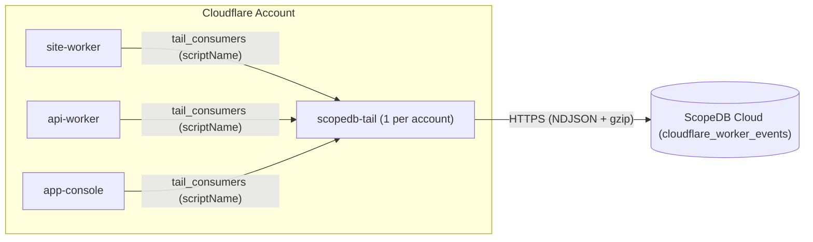

# Cloudflare Tail Worker for ScopeDB

[](https://deploy.workers.cloudflare.com/?url=https://github.com/scopedb/cloudflare-tail-worker)

Stream Cloudflare Worker invocations, `console.*` logs, and uncaught exceptions directly into [ScopeDB](https://www.scopedb.io) without modifying your application Workers.

## How it works

In Cloudflare Workers, a single [Tail Worker](https://developers.cloudflare.com/workers/observability/logs/tail-workers/) (`scopedb-tail`) can receive execution events from any number of producer Workers in the same Cloudflare account via `tail_consumers`. Every event batch delivered by Cloudflare includes the producer Worker's `scriptName`, which `scopedb-tail` maps to the `service` column in ScopeDB:



- **Zero application code changes**: Producer Workers only add `tail_consumers = [{ service = "scopedb-tail" }]` to `wrangler.toml`.
- **Zero Node.js compatibility polyfills**: Built on the [`scopedb`](https://github.com/scopedb/scopedb-js) Web Fetch + `CompressionStream` runtime (`< 10 KiB`, no `nodejs_compat` required).
- **Privacy-first edge web analytics**: Captures Cloudflare edge geography (`continent`, `country`, `region`, `city`, `timezone`, `colo`, `asn`, `as_organization`), referrer (`referer_host`, `referer_path`), and campaign attribution (`utm_source`, `utm_medium`, `utm_campaign`, `ref`) without storing raw client IP addresses or requiring cookies.
- **Safe by default**: Sensitive URL query strings, URL fragments, `Referer` query strings, and sensitive headers (`Authorization`, `Cookie`, `Set-Cookie`) are never stored. Arbitrary `console.log` payloads (`BigInt`, `NaN`/`Infinity`, `Error`, `Date`, circular references) are sanitized before serialization.
- **Cost-efficient on Cloudflare**: Cloudflare Tail Worker invocations do not incur per-request charges and are billed only on Worker CPU milliseconds, bypassing Cloudflare Observability per-GB ingestion and storage meters.

## 3-step quickstart

### 1. Create the table and views in ScopeDB

Apply the Catalog JSON definitions in [`catalog/`](catalog) using the [ScopeDB CLI](https://www.scopedb.io/docs/guides/scopedb-cli/catalog), or open **Data** → **Create table** → **JSON** in ScopeDB Console and paste [`catalog/table.json`](catalog/table.json):

```bash
scope catalog apply --table scopedb.public.cloudflare_worker_events -f catalog/table.json
scope catalog apply --view scopedb.public.v_cloudflare_requests -f catalog/v_cloudflare_requests.json
scope catalog apply --view scopedb.public.v_cloudflare_pageviews -f catalog/v_cloudflare_pageviews.json
scope catalog apply --view scopedb.public.v_cloudflare_errors -f catalog/v_cloudflare_errors.json
scope catalog apply --view scopedb.public.v_cloudflare_ai_bots -f catalog/v_cloudflare_ai_bots.json
```

| Object                                     | Kind  | Definition                                                                   | Purpose                                                                                                             |
| ------------------------------------------ | ----- | ---------------------------------------------------------------------------- | ------------------------------------------------------------------------------------------------------------------- |
| `scopedb.public.cloudflare_worker_events`  | Table | [`catalog/table.json`](catalog/table.json)                                   | Base event table storing `worker.invocation`, `worker.log`, and `worker.exception` rows clustered by `service`      |
| `scopedb.public.v_cloudflare_requests`     | View  | [`catalog/v_cloudflare_requests.json`](catalog/v_cloudflare_requests.json)   | Flattened HTTP/Worker invocation metrics (`wall_time_ms`, `cpu_time_ms`, `colo`, `country`, `user_agent`, `status`) |
| `scopedb.public.v_cloudflare_pageviews`    | View  | [`catalog/v_cloudflare_pageviews.json`](catalog/v_cloudflare_pageviews.json) | Clean browser pageviews excluding link prefetches, RSC payloads, API routes, static assets, and crawlers            |
| `scopedb.public.v_cloudflare_errors`       | View  | [`catalog/v_cloudflare_errors.json`](catalog/v_cloudflare_errors.json)       | All `5xx` responses, non-`ok` Worker outcomes, `console.error` logs, and uncaught exceptions with stack traces      |
| `scopedb.public.v_cloudflare_ai_bots`      | View  | [`catalog/v_cloudflare_ai_bots.json`](catalog/v_cloudflare_ai_bots.json)     | Requests to `/llms.txt` or `*.md` and traffic from AI crawlers and coding agents (`ClaudeBot`, `GPTBot`, `Cursor`)  |

### 2. Deploy `scopedb-tail` once in your Cloudflare account

Click **Deploy to Cloudflare** above, or clone this repository and deploy with Wrangler:

```bash
git clone https://github.com/scopedb/cloudflare-tail-worker.git
cd cloudflare-tail-worker
pnpm install
pnpm exec wrangler secret put SCOPEDB_ENDPOINT
pnpm exec wrangler secret put SCOPEDB_API_KEY
pnpm run deploy
```

| Binding            | Type   | Default                    | Description                                                                   |
| ------------------ | ------ | -------------------------- | ----------------------------------------------------------------------------- |
| `SCOPEDB_ENDPOINT` | Secret | *(Required)*               | ScopeDB Cloud workspace endpoint (for example, `https://<id>.scopedb.cloud`)  |
| `SCOPEDB_API_KEY`  | Secret | *(Required)*               | ScopeDB workspace API key with append access to the target table              |
| `SCOPEDB_DATABASE` | Var    | `scopedb`                  | Target database name in [wrangler.toml](wrangler.toml)                        |
| `SCOPEDB_SCHEMA`   | Var    | `public`                   | Target schema name in [wrangler.toml](wrangler.toml)                          |
| `SCOPEDB_TABLE`    | Var    | `cloudflare_worker_events` | Target table name in [wrangler.toml](wrangler.toml)                           |

### 3. Attach your producer Workers

Add `tail_consumers` to the `wrangler.toml` of each Worker in your Cloudflare account that you want to observe, then redeploy those Workers:

```toml
tail_consumers = [{ service = "scopedb-tail" }]
```

If a producer Worker defines named environments (such as `[env.staging]` and `[env.production]`), add `tail_consumers = [{ service = "scopedb-tail" }]` under each environment block in `wrangler.toml`.

## Example ScopeQL queries

### Compare request volume, errors, and CPU time by Worker service

```scopeql
FROM scopedb.public.v_cloudflare_requests
WHERE occurred_at >= NOW() - '24h'::interval
GROUP BY service
AGGREGATE
    count() AS requests,
    sum(if(status >= 500 OR outcome != 'ok', 1, 0)) AS errors,
    avg(wall_time_ms) AS avg_wall_ms,
    max(cpu_time_ms) AS max_cpu_ms
ORDER BY requests DESC
```

### Inspect recent 5xx failures and uncaught exceptions

```scopeql
FROM scopedb.public.v_cloudflare_errors
WHERE occurred_at >= NOW() - '6h'::interval
SELECT occurred_at, service, event_type, outcome, status, path, message, ray_id, stack
ORDER BY occurred_at DESC
LIMIT 50
```

### See which AI agents and crawlers read `/llms.txt` and Markdown docs

```scopeql
FROM scopedb.public.v_cloudflare_ai_bots
WHERE occurred_at >= NOW() - '168h'::interval
GROUP BY path, user_agent, as_organization
AGGREGATE count() AS fetches
ORDER BY fetches DESC
LIMIT 25
```

### Analyze top external referrers, campaigns, and visitor geography

```scopeql
FROM scopedb.public.v_cloudflare_pageviews
WHERE occurred_at >= NOW() - '168h'::interval
GROUP BY continent, country, referer_host, referer_path, utm_source
AGGREGATE count() AS pageviews
ORDER BY pageviews DESC
LIMIT 25
```

### Correlate all logs and exceptions from a single invocation

```scopeql
FROM scopedb.public.cloudflare_worker_events
WHERE attributes['invocation_id']::string = '<invocation_id>'
SELECT occurred_at, event_type, level, message, attributes
ORDER BY occurred_at ASC
```

## Render web and AI traffic charts with `$scopedb` and `@scopedb/scopeview`

With the [ScopeDB Agent Skill](https://github.com/scopedb/scopedb-skills) (`$scopedb`) and [`@scopedb/scopeview`](https://github.com/scopedb/scopeview), your coding agent can query `v_cloudflare_pageviews` and `v_cloudflare_ai_bots` and export offline interactive HTML charts on demand:

```text
Use $scopedb to analyze our Cloudflare web and AI traffic over the last 168 hours from scopedb.public.v_cloudflare_pageviews and scopedb.public.v_cloudflare_ai_bots, and render @scopedb/scopeview interactive HTML charts for:
1. Hourly or 5-minute pageviews over time (line chart)
2. Top 15 visited pages by path (top-list chart)
3. Top external referrers and UTM sources (top-list chart)
4. Top visitor countries and cities (top-list chart)
5. AI agent and crawler fetches of /llms.txt and *.md by path and bot category (top-list chart)
```

## Custom filtering and sampling

[src/index.ts](src/index.ts) exports `createTailWorker(options)` so you can filter health checks or sample successful `2xx` invocations while keeping `100%` of errors and exceptions:

```ts
import { createTailWorker } from "./src/index.js";

export default createTailWorker({
  shouldRecord: (item) => {
    const status = item.event?.response?.status ?? 0;
    if (item.outcome !== "ok" || status >= 400 || (item.exceptions?.length ?? 0) > 0) {
      return true;
    }
    return Math.random() < 0.25;
  },
});
```

## Development

```bash
pnpm install
pnpm run ci
```

## License

Licensed under the [Apache License, Version 2.0](LICENSE).
